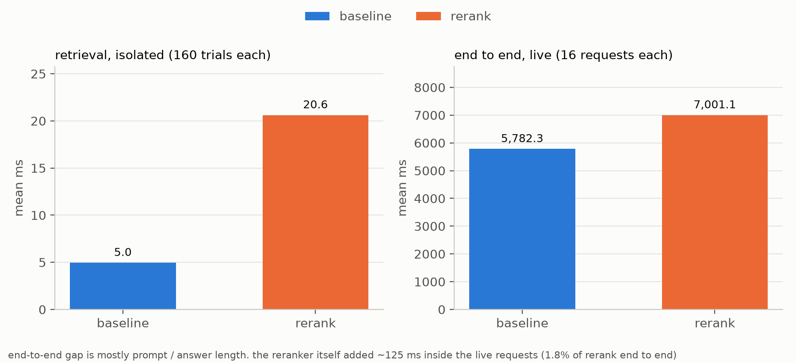

# gdpr rag: bi-encoder vs cross-encoder rerank

lma rag assignment. the same 607 gdpr chunks go through two pipelines: plain bi-encoder retrieval (top 10 -> top 3 -> llm), and the same
top 10 rescored by a cross-encoder (-> top 3 -> llm). same llm, same prompt. everything is in `rag_rerank.ipynb`.

## run

windows, python 3.11, uv and ollama:

```powershell
uv venv .venv --python 3.11
uv pip install --python .venv/Scripts/python.exe -r requirements.txt
.venv/Scripts/python -m ipykernel install --user --name rag-rerank --display-name rag-rerank
ollama pull gemma2:9b-instruct-q4_K_M
.venv/Scripts/python -m nbconvert --to notebook --execute --inplace --ExecutePreprocessor.kernel_name=rag-rerank --ExecutePreprocessor.timeout=3600 --KernelManager.transport_encryption=auto rag_rerank.ipynb
```

ollama has to be running. the notebook is committed with its outputs, so you can just read it. a full run takes about 5 minutes:
the answers come from `results/answers.csv`, only the timing cells call the llm live.

## what's where

```text
rag_rerank.ipynb   all the code + outputs
requirements.txt   pinned packages
data/              inputs: the gdpr pdf, eval + stress questions, answer labels
results/           everything the notebook writes: csvs, figures/, run_info.json
```

## results

16 eval questions, labelled before any run. the 24 stress questions are targeted failure hunting, shown as examples only.

| pipeline | hit@3 | facts@3 | sufficient@3 | mrr@10 |
|---|---:|---:|---:|---:|
| baseline | 0.438 | 0.396 | 0.375 | 0.376 |
| rerank | 0.562 | 0.500 | 0.438 | 0.594 |

- the 10 candidates only hold 64.6% of the needed facts (6/16 questions miss one), rerank can't fix those
- answers, proposed labels not final yet: 4/16 fully correct for baseline, 4/16 for rerank
- retrieval on its own: 5.0 ms -> 20.6 ms. inside the live requests the reranker added ~125 ms
- end to end: 5.78 s -> 7.00 s. that gap is mostly longer prompts and answers, the reranker itself is ~1.8% of it
- cross-encoder over all 607 chunks: ~721 ms per question. at 1M chunks that would be ~20 min (extrapolated, not run)



## notes

- rtx 4070 laptop (8 gb), cuda 12.8. encoders on the gpu, faiss on the cpu. gemma2 doesn't fully fit next to everything else on the desktop,
  ollama ran it 24%/76% CPU/GPU, so generation is slower than on a bigger card
- timings move between runs on this desktop, the csvs are from the last run. 4 of the 32 live timing answers came out slightly different from the cached ones, `latency_llm.csv` marks them
- models: `sentence-transformers/msmarco-MiniLM-L6-cos-v5` @ `14ca9be4bbcf`, `cross-encoder/ms-marco-MiniLM-L6-v2` @ `233902d25c44`, `gemma2:9b-instruct-q4_K_M` (digest in run_info.json)
- pdf: [original 2016 text](https://publications.europa.eu/resource/cellar/3e485e15-11bd-11e6-ba9a-01aa75ed71a1.0006.01/DOC_1), 88 pages, sha256 `bd84e63f5b622b73...`
- left out of the corpus: the title + citations before the recitals, footnotes, and the closing line + signatures after art 99
- the answer labels are a first pass and still need a human check, borderline calls are noted in `data/answer_labels.yaml`
- 16 questions on one document is small, read the numbers as a case study, not a benchmark
